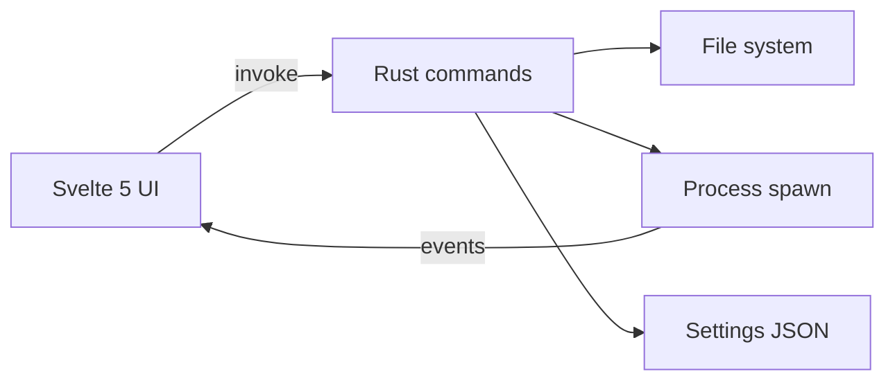

# Architecture

## Overview

VidCompare is a Tauri v2 desktop application with a Svelte 5 frontend and Rust backend.

## IPC Contract

| Command | Signature | Notes |
|---|---|---|
| `list_media_files` | `(dir, include_all) → FileEntry[]` | Lists files in a directory, filtered by video extension |
| `resolve_binary` | `(custom_path?) → BinaryInfo` | Finds video-compare binary, runs `--version` |
| `launch` | `(binary, args) → LaunchHandle` | Spawns video-compare, streams stdout/stderr |
| `kill` | `(id) → ()` | Terminates a running instance |
| `run_info_command` | `(kind, term) → string` | Runs `--find-*` helper commands |
| `load_settings` / `save_settings` | | Portable-aware settings persistence |
| `list_profiles` / `install_profile` | | Option profile management |
| `app_info` | | Version, portable mode, OS, arch |
| `describe_path` | `(path) → { is_dir }` | Classifies a dropped path (folder vs file) for the file panels |
| `embed_available` | `() → bool` | Reports whether in-window embedding is supported on this platform |
| `embed_launch` | `(binary, args, rect) → { id, embedded, reason }` | Spawns video-compare and captures its window over `rect`; `embedded` is false when capture is unsupported/failed |
| `embed_set_rect` | `(id, rect, visible) → ()` | Moves/shows/hides the captured window; identical rects are deduped backend-side |
| `embed_release` | `(id) → ()` | Detaches the captured window (restores ownership) |

## Plugins

`dialog`, `shell`, `opener`, `fs`, `process`, `updater` (minisign-verified
update manifests; portable builds excluded), `log` (debug builds only).

## Window Embedding (Compare)

The dedicated **Compare** page embeds the *real* video-compare window inside
the app — not a recreation. video-compare is spawned as a child process (via the
shared launch machinery, so stdout/stderr still streams to the log panel),
its top-level window is captured by PID, restyled borderless, and reparented
as an **owned** popup positioned over the HTML embed surface. The child keeps
its own process, renderer, and keyboard handling, so the entire upstream
featureset and every keyboard shortcut work unchanged.

- **Capture (Windows)**: `commands::embed_window` finds the child's window
  with `EnumWindows` + `GetWindowThreadProcessId` (retrying briefly after
  spawn), strips the caption/borders, sets `WS_EX_TOOLWINDOW`, and changes
  ownership via `SetWindowLongPtrW(GWL_HWNDPARENT)`. Owned windows always
  sit above their owner's children (including the WebView2 compositor), so
  the captured window reliably covers the placeholder and stays above the
  app while the page scrolls. `GWL_HWNDPARENT` is pointer-sized — the
  32-bit `SetWindowLongW` truncates the owner HWND on 64-bit Windows and
  silently breaks ownership.
- **Tracking**: coordinates are physical pixels relative to the client area;
  the frontend measures CSS rects and scales by `devicePixelRatio`, forwarded
  per animation frame **and** from capture-phase `scroll`/`resize` listeners
  via `embed_set_rect` (backend dedupes identical rects). The backend
  intersects the surface rect with the owner's client area
  (`GetClientRect`), so the captured window is **clipped to the visible
  slice** while the page scrolls and hidden when fully scrolled out of view;
  `SWP_ASYNCWINDOWPOS` keeps it tracking the scroll without waiting for the
  app's paint cycle.
- **Fallback**: when capture fails or is unsupported, `embed_launch` returns
  `embedded: false` with a reason and the child runs in its own window — the
  same behavior as the Launch button. Non-Windows builds compile a stub
  (`embed_window_stub.rs`) where embedding is disabled (macOS forbids
  cross-process reparenting; Wayland lacks a stable foreign-surface protocol
  — see `reports/research-embedding-final.md`).
- **Lifecycle**: `launch://exit` clears the embed state; leaving the compare
  page kills the child. On clean app exit, `RunEvent::Exit` kills every
  managed child; as a crash/panic backstop, all children are assigned to a
  Windows Job Object with `JOB_OBJECT_LIMIT_KILL_ON_JOB_CLOSE`
  (`commands/job.rs`), so the OS terminates them whenever this process dies
  for any reason. `EmbedState::drop` releases every captured window.
- **Licensing**: video-compare stays GPL-2.0 in a separate process; no code
  is shared and no third-party library is loaded.

## Option Profiles

The entire options UI is driven by external JSON files (`src-tauri/profiles/video-compare-latest.json`). Profiles declare:

- Every upstream CLI option (flag, type, help, group, side-applicability)
- Input semantics (multi-right, `__` placeholder, `::` overrides)
- UI layout hints (groups, ordering)

Profiles are versioned (`profileVersion`, `minAppVersion`) and can be swapped without rebuilding the app.

## Side-Aware Options

Options that apply to left/right/both inputs use a two-column layout aligned with the video file panels:

- **Pair options** (`appliesTo: "pair"`): one field per column, with a 🔗 link toggle
- **Left/right-only options**: appear only in their column
- **Global options**: full-width "Shared" section

The argv builder serializes based on `linked` state and `pairStyle` (`separateFlags` or `colon`).
